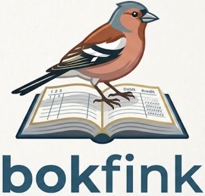
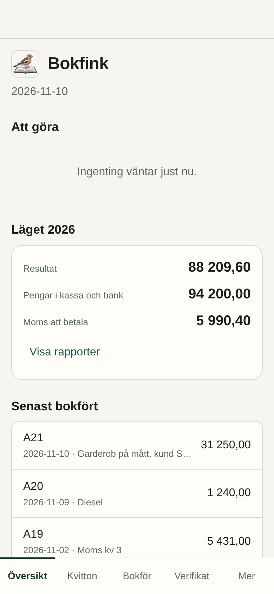
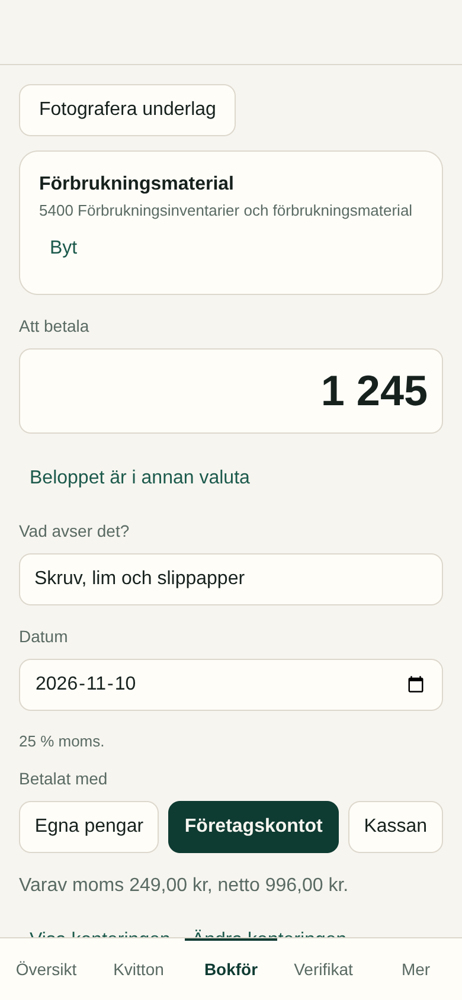
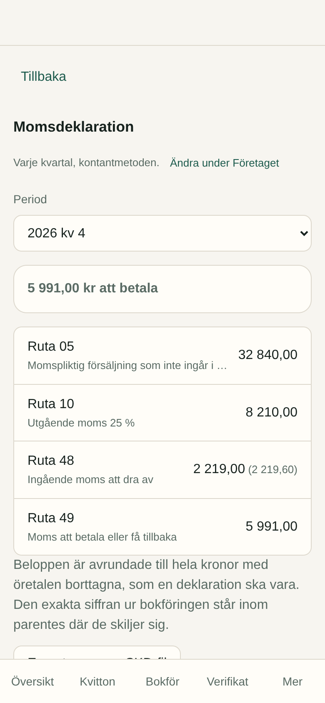
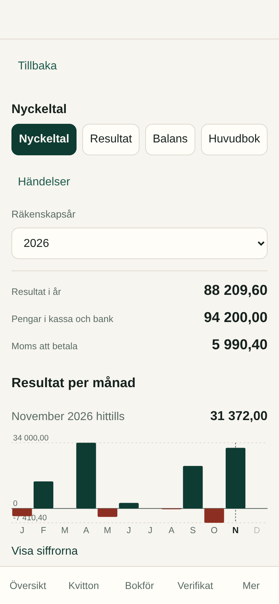

<p align="center"></p>

# Bokfink

Bokföring för enskild firma, i telefonen — utan prenumeration och utan att din bokföring lämnar din enhet.

<p align="center">
  
  
  
  
</p>

<p align="center"><sub>Bilderna visar en påhittad firma.</sub></p>

Bokfink är en app för den som har enskild firma, eller är kassör i en ideell förening, och vill sköta bokföringen själv. Du svarar på vad som har hänt, till exempel "köpt förbrukningsmaterial" eller "fått betalt för ett arbete", och appen väljer konton och räknar ut momsen. Allt sparas på din egen telefon eller dator. Det finns inget konto att skapa och ingen tjänst som kan läsa dina siffror, höja priset eller läggas ner.

## Det här gör appen

- **Bokför på några sekunder.** Sök eller svara på ett par frågor, skriv beloppet, klart. Kvittot fotograferar du direkt, och appen föreslår belopp, moms och datum ur bilden.
- **Räknar fram momsdeklarationen** ruta för ruta, och sparar den som en fil du laddar upp hos Skatteverket.
- **Gör bokslutet:** avskrivningar, obetalda fakturor och bidrag vid årsskiftet och förenklat årsbokslut. För firman också underlaget till NE-bilagan, för föreningen bokslutet enligt BFNAR 2010:1.
- **Visar läget:** resultat, pengar på kontot och moms att betala, med rapporter och diagram.
- **Låser inte in dig.** Bokföringen går att läsa in från och spara till SIE-filer, som andra bokföringsprogram och redovisningsbyråer använder. Säkerhetskopian är en fil du själv bestämmer över.
- **Fungerar utan nät.** Appen läggs på hemskärmen och behöver ingen uppkoppling.

## Passar den dig?

Bokfink passar dig som vill bokföra själv, främst från telefonen, och som är

- **enskild firma** och momsregistrerad, med förenklat årsbokslut (K1), eller
- **kassör i en ideell förening**, till exempel en bygdegårdsförening, som gör förenklat årsbokslut.

Firman och föreningen är två helt åtskilda böcker i samma app, med egna konton, frågor och bokslut. Du väljer vilken sort när du skapar boken under Mer, Böcker, och kan inte ändra det efteråt. Den som är kassör i en förening bredvid sin egen firma kan alltså ha båda på samma telefon.

För en förening finns: föreningens egen kontoplan, frågor anpassade för medlemsavgifter, bidrag och uthyrning av lokal, val av om föreningen är momsregistrerad, eget kapital med ändamålsbestämda medel, projekt på varje konteringsrad med utdrag per projekt, och ett bokslut med jämförelsetal och underskrift av styrelsen. Föreningens budget görs inte i appen; resultatet går att exportera för att jämföra mot budgeten i Excel. Appen avgör inte om föreningen är bokföringsskyldig eller får göra förenklat årsbokslut. Det gör du, och revisorn.

Det här finns **inte** ännu:

- **Firma utan moms.** En enskild firma räknas alltid som momsregistrerad, så den som är momsbefriad får fel bokföring. (En förening kan välja.)
- **Fakturor.** Appen bokför fakturor men skapar dem inte.
- **Att börja med ett tidigare år** utan en SIE-fil från ett annat program.
- **Löner och anställda.** Aktiebolag, handelsbolag, föreningar som måste upprätta årsredovisning och flera användare på samma bok ligger utanför det appen är tänkt för.

I en firmabok är frågorna i dag formade efter en gård med djur. Andra verksamheter går bra att bokföra, men du hittar oftare rätt genom att söka än genom att följa frågorna, och en del vanliga kostnader som lokalhyra och representation saknar färdiga svar.

## Prova

Öppna **https://bokfinken-app.github.io** i telefonen eller datorn. Det finns inget konto att skapa. På telefonen lägger du appen på hemskärmen (Safari: Dela, Lägg till på hemskärmen) så sparas den ordentligt och fungerar utan nät.

Vill du bara titta runt: skapa en egen bok under Mer, Böcker och bokför fritt. Det går att ta bort boken igen därifrån.

Bokföringen sparas i webbläsaren på just den enhet du använder, inte hos någon annan. Det betyder att den inte följer med till en annan telefon eller webbläsare, och att den försvinner om du rensar webbplatsdata. Ta därför en säkerhetskopia under Mer, Säkerhetskopia när du bokfört något du vill behålla.

Hittar du fel eller saknar något: [skriv ett ärende](https://github.com/kanintespela/bokfink/issues). Appen publiceras automatiskt från den här källkoden varje gång en ändring har klarat testerna.

## Status

Bokfink är i bruk för den löpande bokföringen i en riktig firma. Löpande bokföring, moms, kvitton, rapporter, säkerhetskopia, anläggningsregister och årsbokslut är klara. En eSKD-fil med momsdeklaration har laddats upp hos Skatteverket och fungerade; filerna till NE-bilagan är ännu inte prövade där. Detaljerna står i tabellerna under [Funktioner](#funktioner) och i [utvecklingsplanen](docs/UTVECKLINGSPLAN.md).

Appen är en **local-first PWA**. Interna namn i filformat och databas är äldre (`kontera`) och ändras inte, så att tidigare säkerhetskopior och böcker går att öppna.

## Varför

Bokföringsappar för enskild firma kostar löpande, låser in data i leverantörens moln och gör det svårt att komma åt sin egen räkenskapsinformation om man slutar betala. Bokföring är samtidigt ett område där reglerna är offentliga (bokföringslagen, BFN:s allmänna råd, Skatteverkets föreskrifter) och filformaten öppna (SIE, SRU, eSKD). Det finns ingen teknisk anledning till att det ska krävas en prenumeration.

Bokfink bygger på tre val:

1. **Din data är din.** Den ligger på din enhet, i format du kan läsa utan appen.
2. **Inga prenumerationer.** Inga externa API:er, inga betaltjänster, ingen leverantör att bli beroende av. Vill du bokföra från flera enheter kan du synka via en server du själv styr över.
3. **Regelverket i koden.** Momsberäkning, avskrivningar och bokslutsunderlag räknas ut av appen, med källhänvisning till regeln i koden.

## Målgrupp och avgränsning

Bokfink riktar sig till **enskild firma** som upprättar **förenklat årsbokslut enligt K1** (BFNAR 2006:1) och till **ideell förening** som upprättar förenklat årsbokslut enligt BFNAR 2010:1. Föreningen är en egen bok bredvid firmans (Etapp 10). Aktiebolag, handelsbolag, koncernredovisning, löneadministration och flera samtidiga användare ligger utanför projektets mål.

## Funktioner

Status: ⬜ ej påbörjad · 🟡 pågår · ✅ klar · ⏸️ nedprioriterad

### Bokföring
| | Funktion |
|---|---|
| ✅ | Registrering genom ett beslutsträd med BAS K1-konton, med balanskontroll (debet = kredit) i domänen |
| ✅ | Sökbar kontoplan med egna konton och favoriter |
| ✅ | Sökbara svar med källhänvisad moms, de mest använda först, och kontering som kan ändras före bokföring |
| ✅ | Kontantmetod och faktureringsmetod |
| ✅ | Oföränderliga konteringar, annullering, rättelse av beskrivning och datum, obruten nummerserie per serie och år |
| ✅ | Periodlåsning efter inlämnad momsdeklaration, och årsavslut |
| ✅ | Flera räkenskapsår med ingående balanser |
| ✅ | Flera böcker på samma enhet, till exempel firman och en förening, helt åtskilda |
| ✅ | Föreningsprofil: föreningens kontoplan och frågor, val av momsregistrering, projekt per konteringsrad och bokslut enligt BFNAR 2010:1. Budget görs utanför appen, se [utvecklingsplanen](docs/UTVECKLINGSPLAN.md) |

### Moms och skatt
| | Funktion |
|---|---|
| ✅ | Ingående och utgående moms per momskod (25/12/6 %, momsfritt, omvänd skattskyldighet) |
| ✅ | Momsrapport och underlag för momsdeklarationens samtliga rutor |
| ✅ | Export av momsdeklaration som eSKD-fil. En fil har laddats upp hos Skatteverket och fungerade |
| 🟡 | Utlandsköp med omvänd moms: EU-varor och tjänster enligt huvudregeln, 25 % och full avdragsrätt. Andra fall konteras fritt. Periodisk sammanställning kräver kundregistret |
| ✅ | Förenklat årsbokslut enligt K1, årets resultat till eget kapital och omföring av 20xx-kontona |
| 🟡 | Underlag till NE-bilagan med SRU-export för 2024 och 2025 (`INFO.SRU` + `BLANKETTER.SRU`), ännu inte uppladdat hos Skatteverket |
| ⏸️ | Skattemässiga justeringar: räntefördelning, periodiseringsfond, schablonavdrag för egenavgifter |

### Kvitton och registrering
| | Funktion |
|---|---|
| ✅ | Fotografering, beskärning och lagring av kvitton kopplade till verifikationen, och massimport av underlag |
| 🟡 | On-device OCR som föreslår belopp, moms, datum och leverantör; PDF-fakturor läses som text |
| ✅ | Kvittoassistent via Claude som skickar konteringsförslag som utkast att granska. Kräver en egen server, se [server/kvittovakt](server/kvittovakt) |
| ⏸️ | Bankimport från kontoutdrag (CSV) med avstämning |
| ⬜ | Körjournal och milersättning |

### Register
| | Funktion |
|---|---|
| ✅ | Anläggningsregister med avskrivningar enligt K1, fastighetskomponenter |
| 🟡 | Lager (djur) klart; lagerregister för vanligt varulager nedprioriterat |
| ⏸️ | Kund-, projekt- och artikelregister med timtaxor |

### Fakturering
| | Funktion |
|---|---|
| ⏸️ | Fakturor, offerter och betalningspåminnelser som PDF, skapade lokalt |
| ⏸️ | Distribution via enhetens delningsmeny (e-post, Meddelanden, Filer) |
| 🟡 | Obetalda fakturor under faktureringsmetoden: bokförs som kundfordran eller leverantörsskuld och betalas (helt eller delvis) under Mer, Fakturor. Inget kundregister, ingen förfallobevakning |

### Rapporter och export
| | Funktion |
|---|---|
| ✅ | Huvudbok, dagbok, verifikationslista, resultat- och balansräkning med jämförelse mot föregående år |
| ✅ | Diagram för resultat, likviditet och nyckeltal |
| ✅ | SIE-4 export **och** import (migrering av befintlig bokföring) |
| 🟡 | Fullständig JSON-export och återläsning, rapporter som CSV. Äkta Excel avvaktar tills det efterfrågas |
| ✅ | Arkivpaket för sjuårsarkiveringen som går att läsa utan Bokfink |

### Säkerhet
| | Funktion |
|---|---|
| ⏸️ | Lås med Face ID / Touch ID / kod via passkey (WebAuthn) |
| 🟡 | Krypterad säkerhetskopia och synk; databasen på enheten krypteras inte (iOS krypterar redan lagringen) |
| ✅ | Snabb manuell säkerhetskopiering, krypterad eller oskyddad efter eget val, med automatiskt testad återställning (automatisk kopiering nedprioriterad) |
| 🟡 | Synkronisering mellan telefon och dator över egen PocketBase-server, med krypterad nyttolast. Byggd och testad, men servern är inte uppsatt — enheterna byter krypterade kopior som filer |

Fyllig beskrivning av varje punkt, inklusive vad som är tekniskt möjligt i en PWA på iOS och vad som inte är det, finns i [utvecklingsplanen](docs/UTVECKLINGSPLAN.md).

## Designprinciper

- **Local-first.** Enheten är originalet. Allt annat är kopior.
- **Fungerar i flygplansläge.** Ingen funktion får kräva uppkoppling. Det enda nätverksberoendet är synk och säkerhetskopiering mot lagring du själv valt.
- **Öppna format hela vägen ut.** SIE, CSV, JSON, PDF. Ingen data ska kunna bli inlåst i Bokfink.
- **Räkna i heltal.** Alla belopp lagras i öre. Aldrig flyttal.
- **Automatik föreslår, människan bokför.** OCR och beslutsträdet fyller i formulär — de bokför aldrig själva.
- **Regler med källa.** All logik som kommer från lag eller allmänt råd har en hänvisning i koden.

## Teknik

TypeScript · React · Vite · Workbox (service worker) · IndexedDB via Dexie · Web Crypto · WebAuthn · pdf-lib · Tesseract.js · Vitest + Playwright.

Bygget är i drift från och med Etapp 0: appen är installerbar, fungerar offline och har en versionerad databas.

Inga beroenden till externa tjänster i drift. Motiv för varje teknikval finns i [utvecklingsplanen](docs/UTVECKLINGSPLAN.md#5-teknikval).

## Kom igång

```sh
npm install
npm run dev       # utvecklingsserver
npm run verify    # typkontroll, lint, formatering och tester — körs före varje commit
npm run test:e2e  # Playwright mot ett produktionsbygge
npm run build     # produktionsbygge
```

Appen installeras på telefonen genom att öppna den i Safari eller Chrome och välja *Lägg till på hemskärmen*. På iOS krävs installation på hemskärmen för att kamera och beständig lagring ska fungera fullt ut.

I drift serveras det bygge som CI har testat: varje grön push till `main` hamnar på telefonen inom några minuter, utan att någon bygger för hand. Hur det är uppsatt står i [server/app](server/app/README.md).

## Projektstruktur

```
src/domain/     ren bokföringslogik, inga beroenden på ramverk
src/data/       IndexedDB, repositories, schemamigrationer
src/features/   användargränssnitt per funktionsområde
src/ui/         delade komponenter
src/platform/   kamera, delning, WebAuthn, fil-I/O
docs/           utvecklingsplan och beslutsunderlag
```

## Regelverk som Bokfink följer

- Bokföringslag (1999:1078), särskilt kraven på verifikationer, systematisk ordning, rättelser som går att spåra och sjuårig arkivering
- BFNAR 2006:1 (K1) — enskilda näringsidkare som upprättar förenklat årsbokslut
- Mervärdesskattelag (2023:200)
- SIE-formatet enligt Föreningen SIE-gruppens specifikation
- Skatteverkets filformat SRU (inkomstdeklaration) och eSKD (skattedeklaration)

## Ansvarsfriskrivning

Bokfink är ett hobbyprojekt och inte skatte- eller redovisningsrådgivning. Det är alltid den bokföringsskyldige som ansvarar för att bokföringen är korrekt och att arkiveringskraven uppfylls. Kontrollera appens beräkningar mot Skatteverkets och Bokföringsnämndens information innan du lämnar in en deklaration.

## Licens

MIT — se [LICENSE](LICENSE).

## Bidra

Projektet utvecklas av en person med AI-assistans. Konventioner, hårda regler och arbetsflöde finns i [CLAUDE.md](CLAUDE.md) — den gäller lika mycket för människor som för AI-assistenter.
