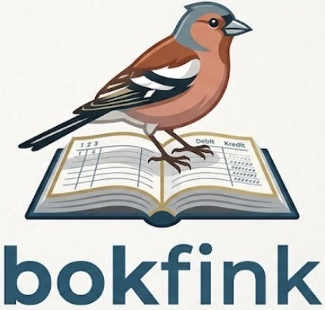

<p align="center"></p>

# Bokfink

Bokföring för enskild firma, i telefonen — utan prenumeration och utan att din bokföring lämnar din enhet.

Bokfink är en **local-first PWA**. Projektet hette tidigare Kontera, och det namnet finns kvar i koden, i filformaten och i databasen. All data ligger på dina egna enheter, appen fungerar offline, och det finns ingen molntjänst som kan höja priset, lägga ner eller läsa dina siffror. Projektet är öppen källkod och byggs för att ersätta kommersiella bokföringsappar för enskild firma.

> **Status: i bruk för den löpande bokföringen.** Etapp 1 och 2 är färdiga: en utgift bokförs på några sekunder genom att svara på vad som hänt, en bokförd kontering rättas med annullering medan beskrivning och datum kan rättas direkt, en befintlig bokföring importeras från SIE-fil och exporteras tillbaka utan förlust, och momsdeklarationen räknas fram ruta för ruta. Kvitton med OCR, rapporter, krypterad säkerhetskopia, synk mellan telefon och dator (byggd, inte driftsatt), anläggningsregister och årsbokslut är i stort sett klara. Kvar är främst att bekräfta eSKD-, NE- och SRU-filerna mot Skatteverket, konfliktvyn för synken, samt fakturering och körjournal — se [utvecklingsplanen](docs/UTVECKLINGSPLAN.md).

## Varför

Bokföringsappar för enskild firma kostar löpande, låser in data i leverantörens moln och gör det svårt att komma åt sin egen räkenskapsinformation om man slutar betala. Bokföring är samtidigt ett område där reglerna är offentliga (bokföringslagen, BFN:s allmänna råd, Skatteverkets föreskrifter) och filformaten öppna (SIE, SRU, eSKD). Det finns ingen teknisk anledning till att det ska krävas en prenumeration.

Bokfink bygger på tre val:

1. **Din data är din.** Den ligger på din enhet, i format du kan läsa utan appen.
2. **Inga prenumerationer.** Inga externa API:er, inga betaltjänster, ingen leverantör att bli beroende av. Vill du bokföra från flera enheter kan du synka via en server du själv styr över.
3. **Regelverket i koden.** Momsberäkning, avskrivningar och bokslutsunderlag räknas ut av appen, med källhänvisning till regeln i koden.

## Målgrupp och avgränsning

Bokfink riktar sig till **enskild firma** som upprättar **förenklat årsbokslut enligt K1** (BFNAR 2006:1). Aktiebolag, handelsbolag, koncernredovisning, löneadministration och flera samtidiga användare ligger utanför projektets mål.

## Funktioner

Status: ⬜ ej påbörjad · 🟡 pågår · ✅ klar · ⏸️ nedprioriterad

### Bokföring
| | Funktion |
|---|---|
| ✅ | Registrering genom ett beslutsträd med BAS K1-konton, med balanskontroll (debet = kredit) i domänen |
| ✅ | Sökbar kontoplan med egna konton och favoriter |
| ✅ | Sökbara svar med källhänvisad moms, de mest använda först, och kontering som kan ändras före bokföring |
| ✅ | Kontantmetod och faktureringsmetod |
| ✅ | Oföränderliga konteringar, annullering, rättelse av beskrivning och datum, obruten nummerserie per serie och år |
| ✅ | Periodlåsning efter inlämnad momsdeklaration, och årsavslut |
| ✅ | Flera räkenskapsår med ingående balanser |

### Moms och skatt
| | Funktion |
|---|---|
| ✅ | Ingående och utgående moms per momskod (25/12/6 %, momsfritt, omvänd skattskyldighet) |
| ✅ | Momsrapport och underlag för momsdeklarationens samtliga rutor |
| 🟡 | Export av momsdeklaration som eSKD-fil, för de rutor vars format är bekräftat |
| 🟡 | EU-handel klar. Periodisk sammanställning visar beloppen men kräver kundregistret |
| ✅ | Förenklat årsbokslut enligt K1, årets resultat till eget kapital och omföring av 20xx-kontona |
| 🟡 | Underlag till NE-bilagan med SRU-export (`INFO.SRU` + `BLANKETTER.SRU`), ännu inte uppladdat hos Skatteverket |
| ⏸️ | Skattemässiga justeringar: räntefördelning, periodiseringsfond, schablonavdrag för egenavgifter |

### Kvitton och registrering
| | Funktion |
|---|---|
| ✅ | Fotografering, beskärning och lagring av kvitton kopplade till verifikationen, och massimport av underlag |
| 🟡 | On-device OCR som föreslår belopp, moms, datum och leverantör; PDF-fakturor läses som text |
| ✅ | Kvittoassistent via Claude som skickar konteringsförslag som utkast att granska |
| ⏸️ | Bankimport från kontoutdrag (CSV) med avstämning |
| ⬜ | Körjournal och milersättning |

### Register
| | Funktion |
|---|---|
| ✅ | Anläggningsregister med avskrivningar enligt K1, fastighetskomponenter |
| 🟡 | Djurlager klart; lagerregister för vanligt varulager nedprioriterat |
| ⏸️ | Kund-, projekt- och artikelregister med timtaxor |

### Fakturering
| | Funktion |
|---|---|
| ⏸️ | Fakturor, offerter och betalningspåminnelser som PDF, skapade lokalt |
| ⏸️ | Distribution via enhetens delningsmeny (e-post, Meddelanden, Filer) |
| ⏸️ | Kundreskontra med betalningsmatchning och förfallobevakning |

### Rapporter och export
| | Funktion |
|---|---|
| ✅ | Huvudbok, dagbok, verifikationslista, resultat- och balansräkning med jämförelse mot föregående år |
| ✅ | Diagram för resultat, likviditet och nyckeltal |
| ✅ | SIE-4 export **och** import (migrering av befintlig bokföring) |
| 🟡 | Fullständig JSON-export och återläsning, rapporter som CSV. Äkta Excel avvaktar tills det efterfrågas |
| ✅ | Arkivpaket för sjuårsarkiveringen som går att läsa utan Bokfink |

### Säkerhet
| | Funktion |
|---|---|
| ⏸️ | Lås med Face ID / Touch ID / kod via passkey (WebAuthn) |
| 🟡 | Krypterad säkerhetskopia och synk; databasen på enheten krypteras inte (iOS krypterar redan lagringen) |
| ✅ | Snabb manuell säkerhetskopiering, krypterad eller oskyddad efter eget val, med automatiskt testad återställning (automatisk kopiering nedprioriterad) |
| 🟡 | Synkronisering mellan telefon och dator över egen PocketBase-server, med krypterad nyttolast. Byggd och testad, men servern är inte uppsatt — enheterna byter krypterade kopior som filer |

Fyllig beskrivning av varje punkt, inklusive vad som är tekniskt möjligt i en PWA på iOS och vad som inte är det, finns i [utvecklingsplanen](docs/UTVECKLINGSPLAN.md).

## Designprinciper

- **Local-first.** Enheten är originalet. Allt annat är kopior.
- **Fungerar i flygplansläge.** Ingen funktion får kräva uppkoppling. Det enda nätverksberoendet är synk och säkerhetskopiering mot lagring du själv valt.
- **Öppna format hela vägen ut.** SIE, CSV, JSON, PDF. Ingen data ska kunna bli inlåst i Bokfink.
- **Räkna i heltal.** Alla belopp lagras i öre. Aldrig flyttal.
- **Automatik föreslår, människan bokför.** OCR och beslutsträdet fyller i formulär — de bokför aldrig själva.
- **Regler med källa.** All logik som kommer från lag eller allmänt råd har en hänvisning i koden.

## Teknik

TypeScript · React · Vite · Workbox (service worker) · IndexedDB via Dexie · Web Crypto · WebAuthn · pdf-lib · Tesseract.js · Vitest + Playwright.

Bygget är i drift från och med Etapp 0: appen är installerbar, fungerar offline och har en versionerad databas.

Inga beroenden till externa tjänster i drift. Motiv för varje teknikval finns i [utvecklingsplanen](docs/UTVECKLINGSPLAN.md#5-teknikval).

## Kom igång

```sh
npm install
npm run dev       # utvecklingsserver
npm run verify    # typkontroll, lint, formatering och tester — körs före varje commit
npm run test:e2e  # Playwright mot ett produktionsbygge
npm run build     # produktionsbygge
```

Appen installeras på telefonen genom att öppna den i Safari eller Chrome och välja *Lägg till på hemskärmen*. På iOS krävs installation på hemskärmen för att kamera och beständig lagring ska fungera fullt ut.

I drift serveras det bygge som CI har testat: varje grön push till `main` hamnar på telefonen inom några minuter, utan att någon bygger för hand. Hur det är uppsatt står i [server/app](server/app/README.md).

## Projektstruktur

```
src/domain/     ren bokföringslogik, inga beroenden på ramverk
src/data/       IndexedDB, repositories, schemamigrationer
src/features/   användargränssnitt per funktionsområde
src/ui/         delade komponenter
src/platform/   kamera, delning, WebAuthn, fil-I/O
docs/           utvecklingsplan och beslutsunderlag
```

## Regelverk som Bokfink följer

- Bokföringslag (1999:1078), särskilt kraven på verifikationer, systematisk ordning, rättelser som går att spåra och sjuårig arkivering
- BFNAR 2006:1 (K1) — enskilda näringsidkare som upprättar förenklat årsbokslut
- Mervärdesskattelag (2023:200)
- SIE-formatet enligt Föreningen SIE-gruppens specifikation
- Skatteverkets filformat SRU (inkomstdeklaration) och eSKD (skattedeklaration)

## Ansvarsfriskrivning

Bokfink är ett hobbyprojekt och inte skatte- eller redovisningsrådgivning. Det är alltid den bokföringsskyldige som ansvarar för att bokföringen är korrekt och att arkiveringskraven uppfylls. Kontrollera appens beräkningar mot Skatteverkets och Bokföringsnämndens information innan du lämnar in en deklaration.

## Licens

MIT — se [LICENSE](LICENSE).

## Bidra

Projektet utvecklas av en person med AI-assistans. Konventioner, hårda regler och arbetsflöde finns i [CLAUDE.md](CLAUDE.md) — den gäller lika mycket för människor som för AI-assistenter.
